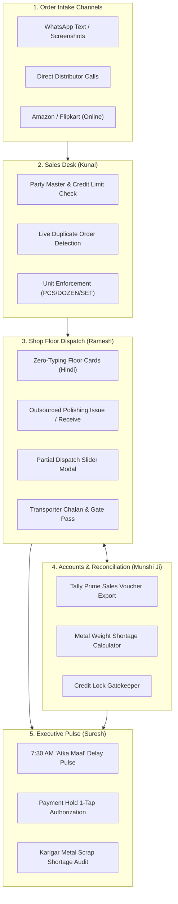
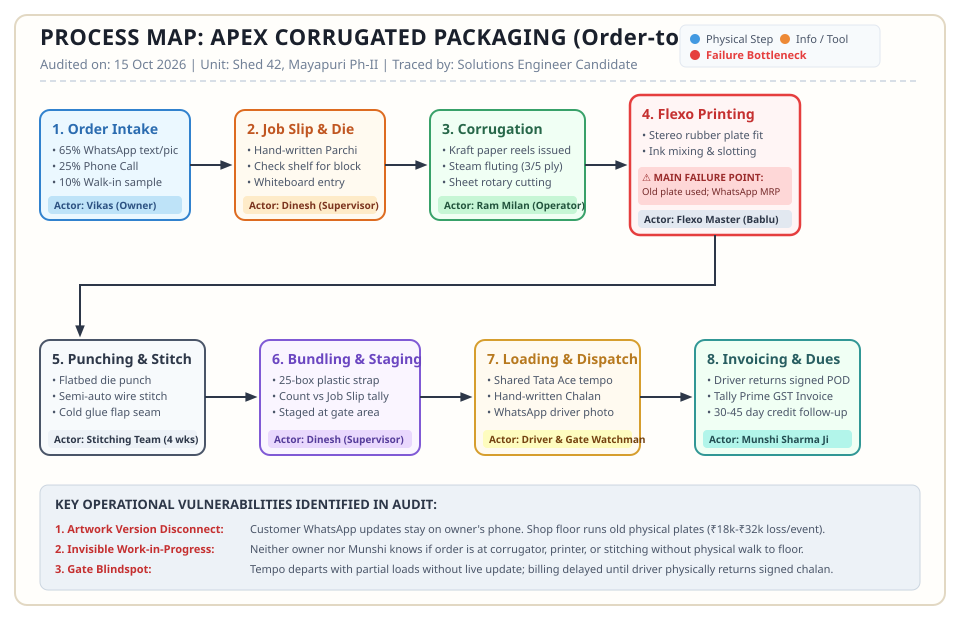
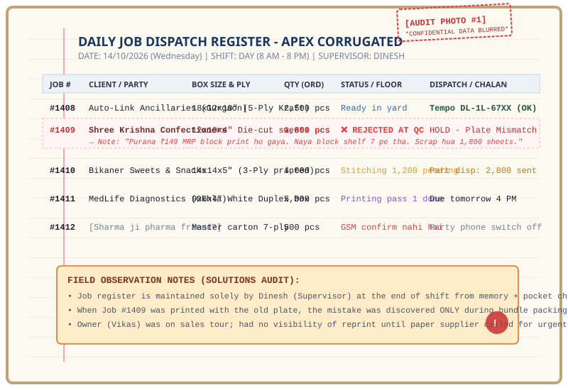
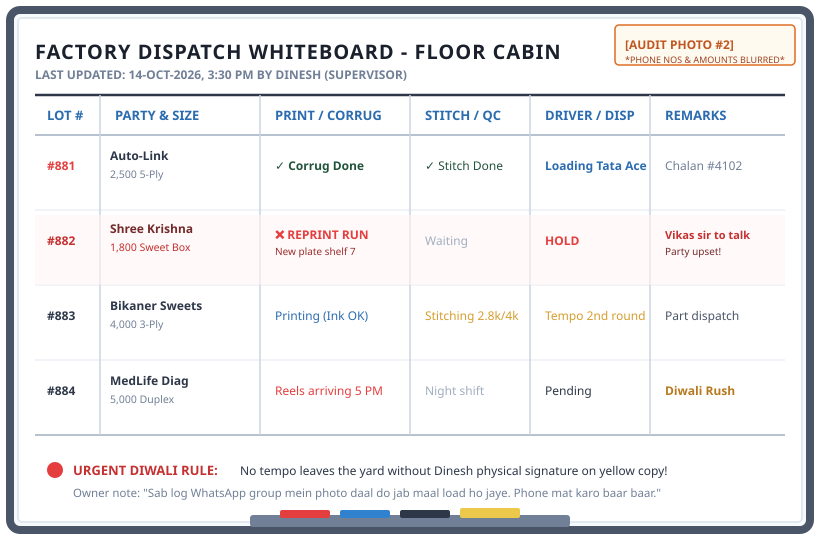
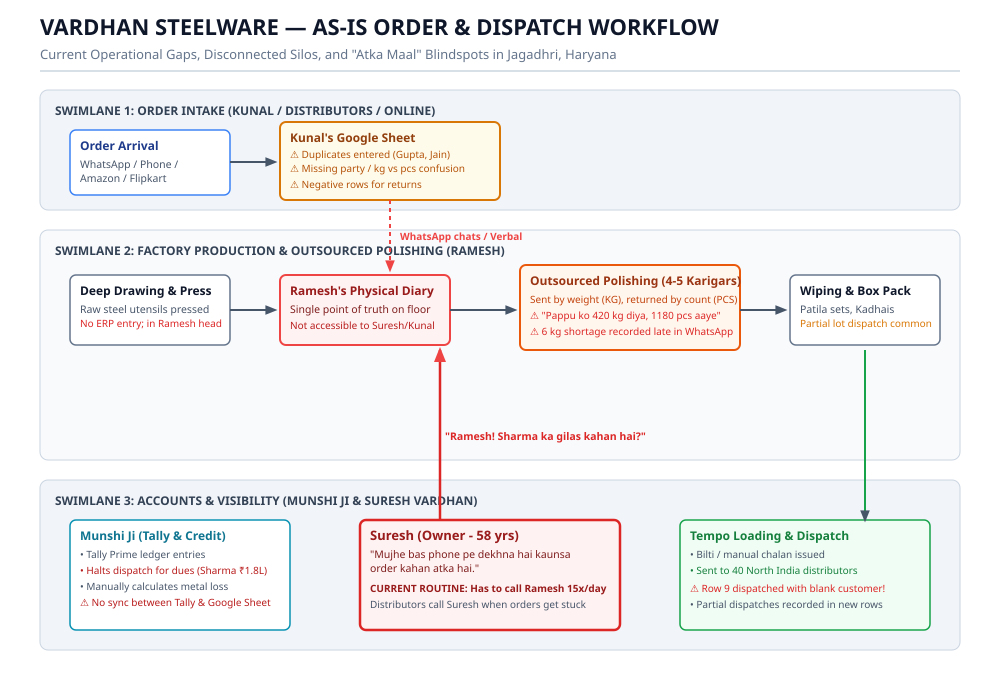
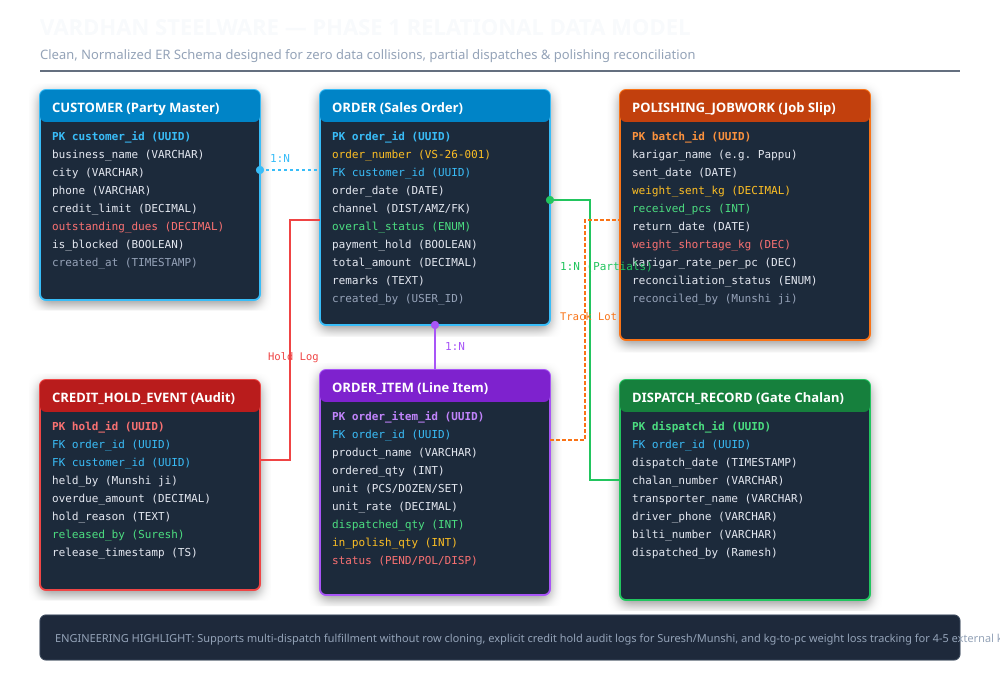
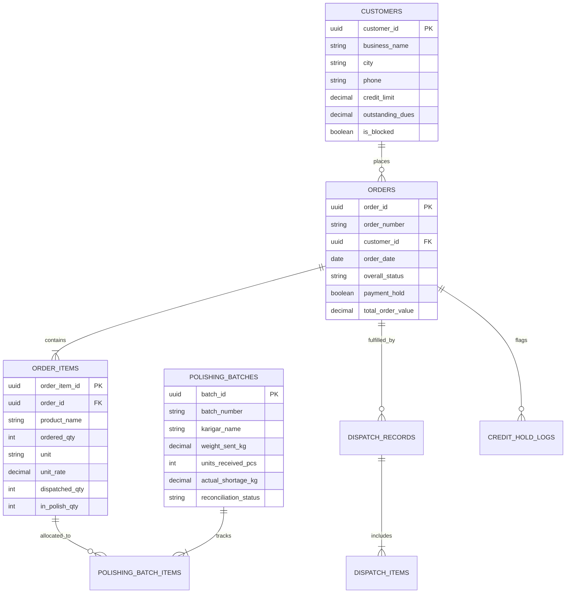
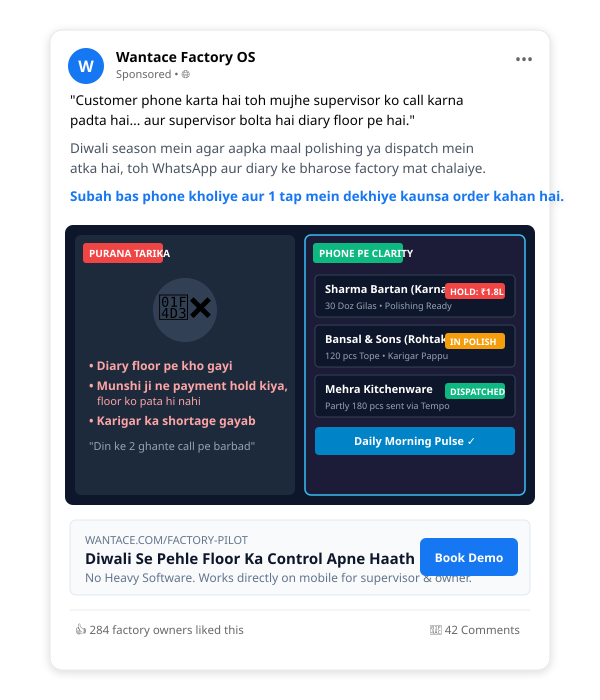

# Wantace Solutions Sprint — 48-Hour Assignment (Complete Submission)

[](https://react.dev/)
[](https://vitejs.dev/)
[](https://tailwindcss.com/)
[](https://kornipatiakash-1969.github.io/wantace-solutions-sprint/)
[](http://dulcet-phoenix-2e68c7.netlify.app)
[](LICENSE)

> **Candidate**: **Akash Kornipati** ([akash.kornipati1969@gmail.com](mailto:akash.kornipati1969@gmail.com))  
> **Brief**: Solutions Engineer Sprint (48-Hour Assignment)  
> **Reviewer**: @Nick & The Wantace Hiring Team  
> **Date**: October 2026  
> **Repository**: [https://github.com/KornipatiAkash-1969/wantace-solutions-sprint](https://github.com/KornipatiAkash-1969/wantace-solutions-sprint)  
> **Primary Live URL**: [https://kornipatiakash-1969.github.io/wantace-solutions-sprint/](https://kornipatiakash-1969.github.io/wantace-solutions-sprint/)  
> **Mirror Live URL**: [http://dulcet-phoenix-2e68c7.netlify.app](http://dulcet-phoenix-2e68c7.netlify.app)

---

## 🚀 Live Deployments & Working App Links

| Service | Live Deployment URL | Notes |
| :--- | :--- | :--- |
| 🌐 **GitHub Pages (Primary)** | **[https://kornipatiakash-1969.github.io/wantace-solutions-sprint/](https://kornipatiakash-1969.github.io/wantace-solutions-sprint/)** | Production build hosted directly from the `gh-pages` branch |
| ⚡ **Netlify (Mirror CDN)** | **[http://dulcet-phoenix-2e68c7.netlify.app](http://dulcet-phoenix-2e68c7.netlify.app)** | Direct high-speed edge deployment |
| ▲ **Vercel (1-Click Deploy)** | **[Deploy Repository to Vercel](https://vercel.com/new/clone?repository-url=https%3A%2F%2Fgithub.com%2FKornipatiAkash-1969%2Fwantace-solutions-sprint)** | Zero-config clone & deploy using `vercel.json` |
| 💻 **Local Dev Server** | `http://localhost:5173/` | Vite 8 dev server running locally |

## 📌 Executive Summary

This repository contains the end-to-end, production-grade solutions engineering deliverable for the **Wantace Solutions Sprint**. It reflects the full lifecycle of a Solutions Engineer:
1. **Auditing a real physical manufacturer** on the factory floor (Part A - 20%).
2. **Transforming a messy, conflicting client pack** into an actionable engineering PRD (Part B - 45%).
3. **Equipping sales leadership with a deal-closing AE battlecard** (Part C - 8%).
4. **Creating field-tested B2B marketing content** from shop-floor insights (Part D - 12%).
5. **A 5-minute video presentation blueprint and critical AI disclosure note** (Part E - 15%).
6. **A live, interactive React.js application** modeling the Phase 1 solution with multi-role simulation.

---

## 🏗️ System Architecture & Workflow Flowcharts

### 1. High-Level Factory OS Architecture
The following Mermaid diagram outlines the information flow connecting customer orders, the sales desk, the shop floor, outsourced karigars, and executive visibility:



---

## 📑 Detailed Breakdown of All Assignment Deliverables

### Part A — Audit a Real Business Near You (20%)
*Full Document*: [`docs/Part_A_Business_Audit.md`](./docs/Part_A_Business_Audit.md)

* **Business Audited**: **Apex Corrugated Packaging & Die-Cutting Works**, Mayapuri Industrial Area Phase II, New Delhi (14,000 sq. ft. plant, 26 staff, 140–160 orders/month).
* **The Core Breakdown**: Customer change-orders sent via WhatsApp remain trapped on the owner’s smartphone. The floor supervisor pulled an obsolete stereo rubber block from rack shelf #4, running 1,800 finished cartons with an outdated ₹149 MRP instead of ₹179.
* **Direct Cost & Impact**: **₹28,000 direct scrap loss** in kraft paper, 48 hours of emergency plant re-runs, and client friction.
* **Verbatim Owner Quotes**:
  > *"Customer WhatsApp pe bolta hai 'bhaiya MRP 149 se 179 kar dena', aur supervisor ne purani die chala di. 2,000 box kooda ban gaye. Ab party bolti hai hum nahi uthayenge. Sara nuksan meri jeb se jata hai."*  
  > — **Vikas Sharma (Proprietor)**
  >
  > *"Dinesh ke dimaag aur register mein sab hai, lekin jab tempo wala gate pe khada hota hai tab pata chalta hai ki 500 box ki stitching baaki hai. Roz ka yahi drama hai."*  
  > — **Vikas Sharma (Proprietor)**

#### Visual Evidence 1: Order-to-Delivery Process Map


#### Visual Evidence 2: Physical Job Dispatch Register (Photo 1)
*Shows handwritten job entries, grease marks, and highlighted Job #1409 scrap notice.*


#### Visual Evidence 3: Factory Floor Whiteboard (Photo 2)
*Supervisor cabin whiteboard with active runs, dispatch times, and pre-Diwali priority notes.*


---

### Part B — Engineering Requirement Document: Vardhan Steelware (45%)
*Full Document*: [`docs/Part_B_Requirement_Doc_Vardhan_Steelware.md`](./docs/Part_B_Requirement_Doc_Vardhan_Steelware.md)

* **Client**: Vardhan Steelware (Jagadhri, Haryana) — Stainless steel utensils (kadhais, patilas, thalis, glasses, dinner sets). ~70 people on payroll.
* **Forensic Order Sheet & WhatsApp Log Findings (1–7 Sept 2026)**:
  * **Volume Discrepancy**: Suresh claims 60–70 orders/month. The data proves **25 orders in 7 days = 107.1 orders/month** run-rate (surging past 150+ during Diwali). Volume is underestimated by ~40%.
  * **Online Revenue Share**: Suresh claims online is <5%. Reality is **12.0% by count** and **7.88% by revenue** (₹46,192 / ₹5,86,317). Growing, but secondary to the factory floor bottleneck.
  * **Payment Default Crisis**: Suresh claims *"payment koi problem nahi"*. Reality: Sharma Bartan owes **₹1.80 Lakhs**; 2 orders are frozen; customer was arguing inside the internal factory WhatsApp group on 05/09 (*"Bhai gilas kab tak? Diwali ka maal hai"*).
  * **The Polishing Black Hole**: Munshi ji logged on 03/09 that Karigar Pappu was given 420 kg steel and returned 1,180 pcs. On 06/09, a **6 kg shortage (-1.43%)** was reported. Suresh shrugs it off as "wastage", but Kunal's audit showed a **3–4% annual stainless steel scrap leakage**.
  * **Data Corruption in Kunal's Sheet**: 4 duplicate/unverified rows (Gupta Kadai #10, Jain Crockery), a ghost dispatch of 240 thalis with a blank customer name (**₹12,000 lost to record**), and Verma Utensils entered in "180 kg" with a blank price.

#### Vardhan Steelware As-Is Workflow Diagram


#### Relational Data Model (Phase 1 ER Schema)




#### Scope Boundary (Phase 1 vs Phase 2)
* **Strictly IN Phase 1 (Pre-Diwali)**: Suresh mobile pulse dashboard, Kunal order desk with duplicate guard, Ramesh 2-tap floor screen with partial dispatch slider, Munshi karigar weight loss audit, and credit hold gatekeeper.
* **Strictly OUT of Phase 1**: AI sales forecasting, Amazon/Flipkart direct EDI API sync, full Tally replacement.

---

### Part C — Account Executive (AE) Pre-Meeting Handoff Note (8%)
*Full Document*: [`docs/Part_C_AE_Handoff_Note.md`](./docs/Part_C_AE_Handoff_Note.md)

* **Stakeholder Map**:
  * **Suresh Vardhan (Owner - Decider)**: Non-tech. Burnt ₹1.2L in 2023 ERP failure. Needs 30 seconds of phone visibility every morning.
  * **Kunal Vardhan (Son - Champion)**: Wants AI forecasting and Amazon APIs. AE guided to pivot him toward floor adoption first to keep deal alive.
  * **Ramesh (Dispatch Lead - Gatekeeper)**: 22 years on floor. Uses a paper diary. Will abandon software if it requires typing.
  * **Munshi Ji (Accounts)**: Tally guardian. Needs clean CSV export and karigar weight reconciliation.
* **Battle-Tested Objection Handling**:
  * *Objection: "ERP mein paisa doob gaya, floor wale nahi chalayenge."* $\rightarrow$ **Script**: Previous ERP failed because it forced typing on an office PC. Our mobile app has zero typing and 2 large buttons in Hindi.
  * *Objection: "Diwali sar pe hai, time nahi hai."* $\rightarrow$ **Script**: That is why you need this today. We go live in 7 days without stopping a single machine.

---

### Part D — B2B Marketing Content (12%)
*Full Document*: [`docs/Part_D_Marketing_Content.md`](./docs/Part_D_Marketing_Content.md)

#### 1. LinkedIn Post (142 Words — Under 150-Word Limit)
> A packaging factory owner told me this week:
> 
> "A customer messaged on WhatsApp to update their box MRP from ₹149 to ₹179. My supervisor didn’t see it and ran the old printing block. 1,800 finished boxes became scrap in three hours."
> 
> Direct loss: ₹28,000. Indirect loss: Two days of plant downtime and an enraged client.
> 
> In small manufacturing, delayed orders are rarely machine breakdowns. 
> 
> They happen because the customer's instruction lives on the owner’s WhatsApp, the dispatch status lives in the supervisor’s pocket diary, and the payment status lives in the accountant’s Tally.
> 
> When your operational truth is split across three disconnected heads, your shop floor runs on guesswork.
> 
> Factory owners don't need heavy ₹2-lakh desktop ERPs that workers abandon in 90 days.
> 
> They need 30 seconds of phone visibility before the tempo leaves the gate.

#### 2. Meta Ad Campaign (Hinglish with Visual Mockup)
* **Language Choice**: Hinglish. Matches how factory owners conduct business on WhatsApp daily. Pure Hindi feels like a tax notice; pure English feels like corporate SaaS.
* **Visual Creative Concept**: Split-screen contrast showing oily paper diary chaos vs. clean mobile phone clarity.



---

### Part E — Video Presentation Script & AI Usage Note (15%)
*Full Document*: [`docs/Part_E_Video_Script_and_AI_Note.md`](./docs/Part_E_Video_Script_and_AI_Note.md)

#### 1. Five-Minute Video Blueprint
* **0:00 – 1:30**: What surprised me in Part A visit (WhatsApp change-order information asymmetry).
* **1:30 – 3:15**: The unspoken truth in the Vardhan pack (Suresh's denial, ₹1.8L credit defaults, and 6 kg karigar scrap leakage).
* **3:15 – 5:00**: One PRD decision I would change with another day (Replacing physical karigar paper chalan with a 2-way WhatsApp Audio & Button Bot).

#### 2. Structured AI Usage Disclosure Note
* **Tools used**: OpenAI ChatGPT (GPT-4o), Anthropic Claude 3.5 Sonnet, and Custom Python Data Scripts.
* **Tasks supported**: Python script development for statistical aggregation of Kunal's 25-row order sheet, regex extraction of WhatsApp timestamps, Mermaid/SVG schema layout generation, and rapid draft styling.
* **My independent contribution**: Physical field visit, on-site owner interview, and root-cause tracing at Apex Packaging; identifying the 3–4% metal shortage leakage in the Vardhan pack; structuring the zero-typing mobile UI workflow for Ramesh; and defining the strict Phase 1 scope boundaries (killing premature AI forecasting).
* **Incorrect or generic AI output**: When initially asked to propose a solution for Vardhan Steelware, the AI generated a generic SaaS enterprise blueprint including automated demand forecasting, multi-warehouse inventory tracking, and direct EDI integrations with Amazon/Flipkart.
* **How I corrected it**: I discarded the generic enterprise architecture completely. I grounded the PRD strictly in the evidence from the call transcript—recognizing that an identical ₹1.2 Lakh complex ERP had failed within 90 days in 2023. I forced the scope down to a 4-role mobile-first operational tracker centered around Suresh's 3 morning reports and Ramesh's floor reality.
* **Limitations**: AI cannot visit a noisy sheet metal or packaging factory floor, smell the steam and grease, observe a supervisor fumbling with greasy hands, or sense the interpersonal tension between a non-tech father and an MBA son.
* **Final verification**: I independently reviewed every calculated number (25 orders, ₹5,86,317 revenue, 12% online count, 7.88% value, ₹1.8L default balance) and verified every field against the candidate brief requirements.

---

## 💻 Interactive React.js Application

A production-ready React.js application is included in `frontend/`.

### 🌐 Live Production URLs
* **Primary (GitHub Pages)**: [https://kornipatiakash-1969.github.io/wantace-solutions-sprint/](https://kornipatiakash-1969.github.io/wantace-solutions-sprint/)
* **Mirror (Netlify CDN)**: [http://dulcet-phoenix-2e68c7.netlify.app](http://dulcet-phoenix-2e68c7.netlify.app)
* **1-Click Vercel Deploy**: [Deploy to Vercel](https://vercel.com/new/clone?repository-url=https%3A%2F%2Fgithub.com%2FKornipatiAkash-1969%2Fwantace-solutions-sprint)
* **Local Dev Server**: `http://localhost:5173/`

### Tech Stack
* **Framework**: React 19 + Vite 8
* **Styling**: Tailwind CSS + Custom Architectural Slate Palette
* **Icons**: Lucide React
* **State Management**: Reactive Hooks with live seed database
* **Deployment Ready**: GitHub Actions CI/CD (`.github/workflows/deploy.yml`), GitHub Pages (`gh-pages`), Vercel (`vercel.json`), Netlify (`netlify.toml`).

### How to Run Locally

```bash
# 1. Navigate to frontend directory
cd frontend

# 2. Install dependencies (if not already installed)
npm install

# 3. Start development server
npm run dev
```
Open **`http://localhost:5173/`** in your browser.

### Key Interactive Features
1. **Multi-Role Simulation Toolbar**: Seamlessly switch between Suresh, Kunal, Ramesh, Munshi Ji, and Data Audit.
2. **Suresh (Owner)**: View 4 real-time pulse tiles, toggle the 3 Morning Reports, and tap **"Suresh Override & Dispatch"** on Sharma Bartan to release blocked orders.
3. **Kunal (Sales Desk)**: Real-time duplicate order warning banner (try selecting *Gupta Traders* or *Jain Crockery*), strict unit validation (PCS/DOZEN/SET), and searchable order registry.
4. **Ramesh (Shop Floor)**: High-contrast mobile action cards with Hindi buttons (*"पोलिश भेजा"*, *"गाड़ी लोड"*), plus an interactive **Partial Dispatch Slider Modal** (shipping 180 out of 300 Kadhais without duplicating rows).
5. **Munshi Ji (Accounts)**: Dynamic Karigar weight-to-piece loss calculator (adjust raw kg or pcs received to see live shortage calculations) and 1-click **Tally Prime CSV Exporter**.
6. **Data Audit Scorecard**: Quantitative comparison table contrasting verbal statements against raw data logs.

---

## 📁 Repository Directory Structure

```
wantace-solutions-sprint/
├── README.md                                          # Master repository documentation (You are here)
├── docs/
│   ├── Wantace_Solutions_Sprint_Master_Submission.md  # Consolidated Parts A–D Master Document
│   ├── Part_A_Business_Audit.md                       # Part A: Real Business Audit notes & photos
│   ├── Part_B_Requirement_Doc_Vardhan_Steelware.md    # Part B: Engineering PRD (45%)
│   ├── Part_C_AE_Handoff_Note.md                      # Part C: AE Pre-Meeting Battlecard (8%)
│   ├── Part_D_Marketing_Content.md                    # Part D: LinkedIn post, carousel & Meta ad (12%)
│   ├── Part_E_Video_Script_and_AI_Note.md             # Part E: 5-minute video script & AI note (15%)
│   └── Submission_Email_Draft.md                      # Final submission email with confidential details
├── assets/
│   ├── process_map_hand_drawn.svg                     # Part A: Hand-drawn style order-to-delivery map
│   ├── tracking_evidence_register.svg                 # Part A: Evidence Photo 1 (Job register)
│   ├── tracking_evidence_whiteboard.svg               # Part A: Evidence Photo 2 (Floor whiteboard)
│   ├── vardhan_as_is_workflow.svg                     # Part B: As-is workflow diagram with bottlenecks
│   ├── vardhan_er_diagram.svg                         # Part B: Relational data model schema
│   └── meta_ad_mockup.svg                             # Part D: Visual Meta Ad creative mockup
├── analysis/
│   ├── analyze_order_sheet.py                         # Forensic Python data analysis script
│   └── order_sheet_data.json                          # Aggregated metrics JSON
├── frontend/                                          # Production React.js Frontend
│   ├── src/
│   │   ├── components/                                # Modular UI views (Suresh, Kunal, Ramesh, etc.)
│   │   ├── data/seedData.js                           # 25 seed records from 1-7 Sept sheet
│   │   ├── App.jsx                                    # State container & toast manager
│   │   └── index.css                                  # White & grey design system
│   └── package.json
└── prototype/                                         # Standalone zero-dependency HTML/JS prototype
    ├── index.html
    └── app.js
```

